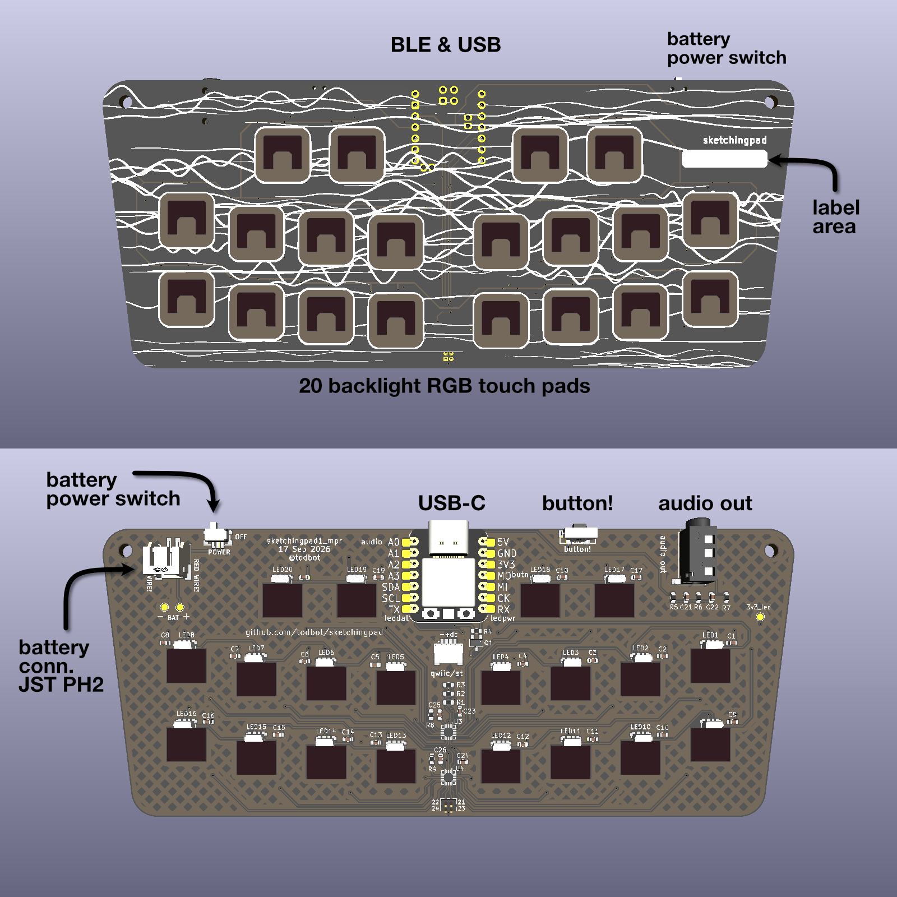

# SketchingPad - 20-key BLE touch pad

## Features

* 20-pad capacitive touch surface with 20 SK6812 addressable LEDs backlighting the touchpads
* [XIAO nRF52840](https://wiki.seeedstudio.com/XIAO_BLE/) BLE w/ LiPo charging
* LiPo battery jack with power switch
* Tact switch to switch modes, wake up, or go into deep sleep
* Audio out jack for audio fun

## Software

Install pre-built apps using the 
**-| [sketchingpad web flasher](https://todbot.github.io/sketchingpad/) |-**

### Arduino

Most of the apps are Arduino sketches, see [`arduino/README.md`](./arduino/README.md) 
for details on Arduino firmware options including: how to flash, how to build, 
the touch layer, the BLE LED animation packet layer, 
the power tiers, etc. Examples of what's available:

* `sketchingpad_party`    -- record an animation, broadcast it, with power tiers
* `sketchingpad_midi_simple` -- USB + BLE MIDI controller
* `ble_keyboard`          -- BLE HID keyboard, with power tiers
* `ble_keyboard_simple`   -- BLE HID keyboard, no power mgmt
* `hwtest_leds`           -- chases one pixel around the 20 LEDs
* `hwtest_touch_lowpower` -- pad -> LED, fading, plus three power tiers, no BLE
* `hwtest_touch`          -- pad -> LED with a fading trail, no BLE

more sketches in [arduino/README.md](./arduino/README.md).

`arduino/tests/` holds host-native tests for the dependency-free
headers: `cd arduino/tests && make run`.

### CircuitPython

CircuitPython is much easier to work with, but can't get the same low-power
modes available in Arduino. 

Each program directory holds the files to copy to the CIRCUITPY root.

* `sketchingpad_midi_simple` -- USB + BLE MIDI controller
* `ble_keyboard_lowpower` -- low-power BLE HID keyboard, 
   two power tiers rather than the Arduino sketch's three. 

These work on both versions of the board (TS20 & MPR121). 
Other programs listed in [circuitpython/README.md](./circuitpython/README.md)

Host tests for the touch layer, needing no board and no install:
`cd circuitpython/tests && make run`. They also pin the pad tables in
`touch.py` against `arduino/shared/touch_map.h`, which nothing else does.

Libraries come from circup; see `circuitpython/requirements.txt`.
See `circuitpython/notes-lowpower.md` for why only two power tiers and not three.

### Other

`docs/hardware-notes.md` is the board side: both touch chips, their pad
numbering, their INT lines, and the board changes the firmware assumes.
`docs/` also holds `low-power-notes.md` and the touch-chip datasheets.

## Hardware Design

The goal was to create a small 20 captouch pad keyboard-like board that let people 
in the same room share color patterns they "draw" on the pads, wirelessly, 
but then also could be something useful after the Sketching conference.
Also desired was that the whole PCB being low-complexity and inexpensive, 
using JLC SMD PCBA capabilities and light hand-soldering. 

The design points then:

- Small : XIAO/QTpy-format or "Supermini"-format MCU board 
- Wireless: NRF52 or ESP32 class board for WiFi/BLE 
- Low-power: NRF52 (ESP32 has 10x idle power draw and nRF can hit microamp SLEEP)
- Battery: LiPo charger or 1.5V boost converter. 1.5V boost too inefficient, 
  so LiPo charger,  built-in to SuperMini and some XIAO-format boards
- Touch sensing: I2C touch sensor chip with 20+ electrodes and INT pin support, 
  and low quiescent current
- LEDs: backlit touchpads, not cutout

Decisions:

- MCU: XIAO NRF52840 - BLE and built-in LiPo charging in 1" sq package.
  Runner up: NRF52840 SuperMini (nice!nano clones), but suspect build quality.
  By going with XIAO/QTPy-format boards, other similar boards could be used, 
  at the expense of the battery connections (which are in a non-standard location)
  for USB-only uses. 

- Touch chip: TS20 - cheap on LCSC and was always in stock, except during
  final production, so a quick switch to 2x MPR121.  Both had 100 uA idle current
  and less in sleep mode but don't use sleep mode yet.
  
- LEDs: SK6812-SIDE-A to backlight the touchpads. Backlight through PCB costs
  power, using Neopixel-like LEDs costs power (but these are static 0.25mA/LED). 
  Using Neopixel-like LEDs on a battery-conscious design is foolish, but after
  spending weeks attempting to route an IS31FL3731 RGB design, I punted.
  The LEDs do at least have a PFET gating the power so we can save 5mA when
  not actively driving the LEDs.  

## Enclosure

As seen in the photos, there is a simple [3d-printable enclosure](./enclosure). 
It's fast to print and you can snap the PCB in to quickly get started,
or use M2.5 screws and nuts to secure the PCB more permanently.

**Battery note:** if you have a battery, attach the it with double-sided tape to the PCB 
and install the combined assembly in the case. 

**Installation into case:** The snaps are on the top and the bottom.  
To fit the PCB, secure it under the lower snap first, 
then rotate the PCB down until it snaps with the top snaps.

**Removal of the case:** To remove the PCB from the case, 
carefully pry the top of the PCB away, working slowly on each side. 
Use the cutout holes for the button and audio jack as a place to start. 

See the [Demos](#demos) section below for a video of installation & removal.

## Pinout

The `sketchingpad1` and `sketchingpad1_mpr1` boards have the same pinout:

| Signal      | XIAO pin | Notes                         |
|-------------|----------|-------------------------------|
| `PWM_AUDIO` | D0 / A0  | to audio jack via RC filter   |
| `BUTTON`    | D10/MOSI | SW1 to GND, internal pull-up  |
| `TOUCH_INT` | D3 / A3  | open collector, R1 pulls up   |
| `SDA`       | D4       | `Wire` default                |
| `SCL`       | D5       | `Wire` default                |
| `LED_DAT`   | D6 / TX  | Neopixel data                 |
| `LED_POWER` | D7 / RX  | PFET gate, LOW = LED rail on  |

Unused pins: D1 / A1, D8 / SCK, D9 / MISO.

Note for battery power, you need to solder the BAT+ / BAT- pins on the bottom
of the XIAO to the corresponding pads on the PCB. 

## Schematics

There are two versions of the board:

- `sketchingpad1` - uses one TS20 touch chip
- `sketchingpad1_mpr` - uses two MPR121 touch chips

KiCad source files available in the "schematics" directory. 

### sketchingpad1  (TS20)

### sketchingpad1-mpr  (2xMPR121)

## Demos

###  sketchingpad1_party demo

Sketch a color pattern with your fingers on the bottom 16 pads.
After 1.5s of pause, it transmits that pattern to all other sketchingpad1_party boards.
Top 4 pads select which colors. Each pad toggles between two colors.

https://github.com/user-attachments/assets/d27a3079-bf75-4f49-8079-a613aa76e5e4

### Case install / removal

How to install & remove the case. 

