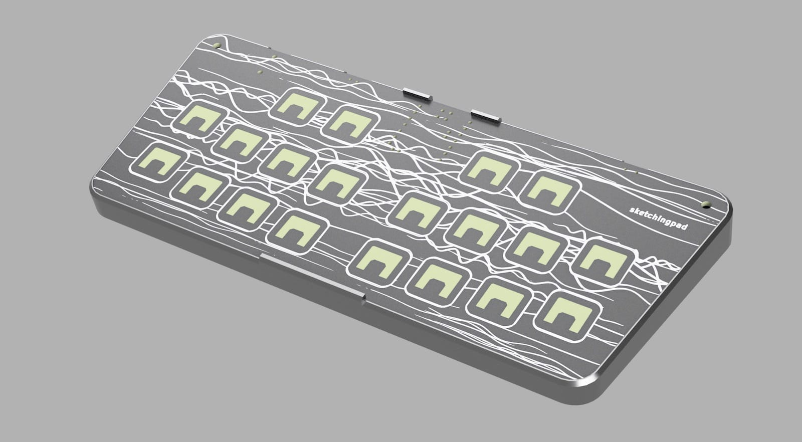
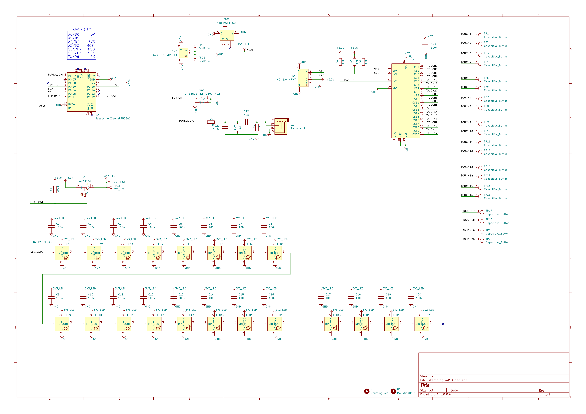
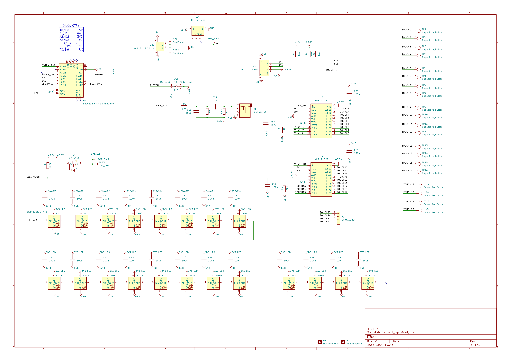

# SketchingPad

## Features

* 20-pad capacitive touch surface with 20 side-view SK6812
  addressable LEDs.
* Driven by a Seeed XIAO nRF52840 that plugs into the board.
* The LED rail is switched by a P-FET, so it can be powered down
  completely rather than just blanked.
* Two board revisions: `sketchingpad1` uses one TS20 touch chip,
  `sketchingpad1_mpr` uses two MPR121s.
* Pad -> LED with fading trails, on either touch chip through a
  shared touch layer.
* BLE HID keyboard: touching a pad types a character.
* Three power tiers, down to ~1-3 uA in SYSTEM_OFF.
* Connectionless BLE broadcast: a board records a touch animation and
  every board in range replays it, with no pairing and no connection
  limit.

## Software

`arduino/README.md` is the reference for the firmware: pinouts, the
two touch chips, the power tiers and the numbers measured on
hardware. The lists below are an index of what is in the tree.

`docs/` holds the touch-chip datasheets, `low-power-notes.md` and
`touch-layer-plan.md`.

### Arduino

Sensor-agnostic, at the top of `arduino/`. These probe I2C through
`touch.h` and run on either board; start here.

* `hwtest_leds`           -- chases one pixel around the 20 LEDs
* `hwtest_touch`          -- pad -> LED with a fading trail
* `hwtest_touch_lowpower` -- same, plus three power tiers, no BLE
* `ble_broadcast`         -- symmetric BLE broadcast, no pairing
* `ble_broadcast_auto`    -- `ble_broadcast`, auto-sending a counter
* `ble_broadcast_anim`    -- record an animation, broadcast it
* `ble_keyboard_simple`   -- BLE HID keyboard, no power mgmt

TS20-only, in `arduino/ts20/`. The low-power BLE HID keyboard exists
only here.

* `hwtest_ts20`                -- pad -> LED, poll or INT
* `hwtest_lowpower_ts20`       -- pad -> LED, three power tiers
* `ble_keyboard_simple_ts20`   -- BLE HID keyboard, no power mgmt
* `ble_keyboard_lowpower_ts20` -- BLE HID keyboard, three tiers
* `ble_broadcast_anim_ts20`    -- record an animation, broadcast it

MPR121-only, in `arduino/mpr/`.

* `hwtest_mpr`       -- pad -> LED on the 2x MPR121 board
* `hwtest_bench_mpr` -- 1-2 MPR121s, touch to serial, no LEDs

`hwtest_touch`, `hwtest_touch_lowpower`, `ble_broadcast_anim` and
`ble_keyboard_simple` supersede `hwtest_ts20`, `hwtest_lowpower_ts20`,
`hwtest_mpr`, `ble_broadcast_anim_ts20` and `ble_keyboard_simple_ts20`,
which stay until the replacements have run on both boards.
`hwtest_bench_mpr` is not superseded: one chip, serial only, no LEDs,
a different instrument.

`arduino/tests/` holds host-native tests for the dependency-free
headers: `cd arduino/tests && make run`.

### CircuitPython

The CircuitPython programs target the TS20 board (`sketchingpad1`);
there is no MPR121 support here. Each program directory holds the
file to copy to the CIRCUITPY root as `code.py`.

* `ble_keyboard_lowpower/code.py` -- low-power BLE HID keyboard, two
  power tiers rather than the Arduino sketch's three
* `hwtest/code_test_ts20.py` -- lights an LED for each touched pad
* `hwtest/code_ledtest.py` -- LED chase, no touch
* `hwtest/code_pwmaudio_test1.py` -- synthio/audiopwmio tone on D0
* `hwtest-orig/code.py` -- an earlier pass, targeting a nice!nano /
  nRF52840 supermini rather than this board

`arduino/hwtest_leds` and `arduino/ts20/hwtest_ts20` are Arduino ports
of `code_ledtest.py` and `code_test_ts20.py`.

Libraries come from circup; see `circuitpython/requirements.txt`.
That includes `ts20.py`, the TS20 driver, although a copy of it also
sits in `hwtest-orig/`. `circuitpython/notes-lowpower.md` covers why
there are two power tiers and not three.

## Enclosure

As seen in the photos, there is a simple [3d-printable enclosure](./enclosure). 
It's fast to print and you can snap the PCB in to quickly get started,
or use M2.5 screws and nuts to secure the PCB more permanently.

## Pins used

* BUTTON     - D10/MOSI (SW1 to GND, needs internal pull-up)
* TOUCH_INT  - D3 / A3  (open collector, R1 pulls up)
* SDA        - D4       (Arduino Wire default)
* SCL        - D5       (Arduino Wire default)
* LED_DAT    - D6 / TX
* LED_POWER  - D7 / RX  (P-FET gate: LOW = rail on)

## Schematics

There are two versions of the board:

- `sketchingpad1` - uses one TS20 touch chip
- `sketchingpad1_mpr` - uses two MPR121 touch chips

KiCad source files available in the "schematics" directory. 

### sketchingpad1  (TS20)

### sketchingpad1-mpr  (2xMPR121)

